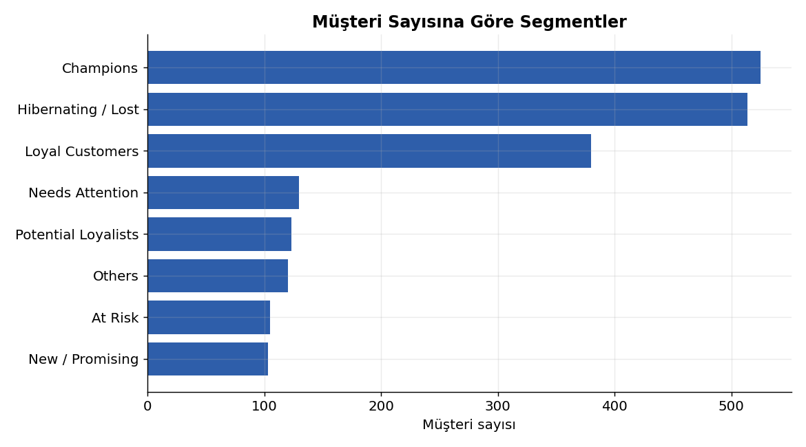
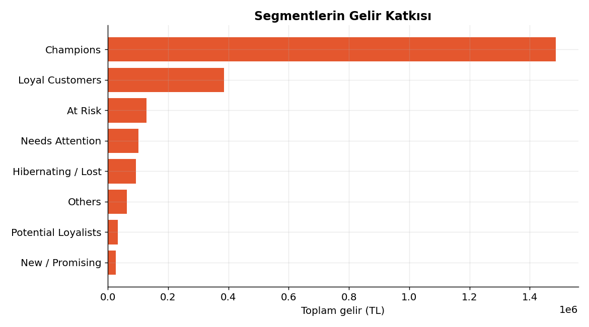

# Customer Segmentation with RFM

Customers are scored on Recency (days since last purchase), Frequency
(number of orders) and Monetary value (total spend), then grouped into
segments to see who the best customers are and who is about to churn.

| | |
|---|---|
|  |  |

## Data

18,004 transactions from 2,000 customers over two years, analysed as of
1 January 2026. The data is synthetic and comes from
`python/01_generate_data.py`.

## Method

Each of R, F and M gets a 1–5 score with `NTILE(5)` (recency is reversed,
since a recent purchase is better). Segments are assigned from the R score
and the average of F and M, e.g. R ≥ 4 and F/M ≥ 4 is *Champions*,
R ≤ 2 and F/M ≥ 4 is *At Risk*.

## Results

| Segment | Customers | Share of customers | Share of revenue |
|---|--:|--:|--:|
| Champions | 525 | 26% | 64% |
| Loyal Customers | 380 | 19% | 17% |
| At Risk | 105 | 5% | 6% |
| Hibernating / Lost | 514 | 26% | 4% |

- A quarter of the customers bring in almost two thirds of revenue, so
  keeping the Champions matters more than anything else.
- At Risk customers used to buy often (about 11 orders) but have not
  bought for about 268 days. They are the first group for a win-back offer.

## Files

- `sql/rfm_segmentation.sql`: RFM scores with `NTILE` and the segment summary (PostgreSQL)
- `python/02_rfm_analysis.py`: the same scoring in pandas
- `reports/rfm_table.csv`, `reports/segment_summary.csv`, `reports/charts/`
- `powerbi/measures.dax`, `powerbi/portfolio_theme.json`: Power BI measures and theme

## Run

```bash
pip install -r requirements.txt
python python/01_generate_data.py
python python/02_rfm_analysis.py
```

